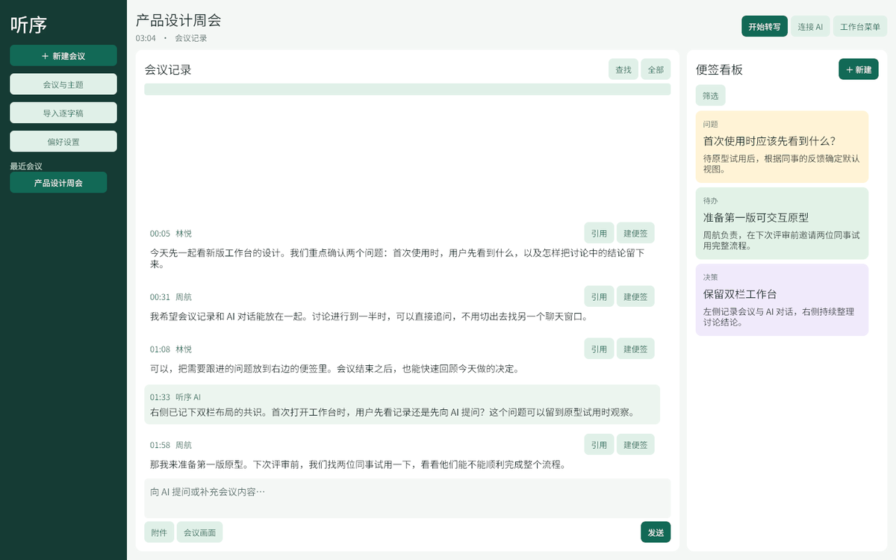

# 听序 Tingsu

听序是一款支持 Linux（Wayland、X11）和 Windows 的桌面会议工作台。左侧按时间记录发言、你的插话和 AI 回复，右侧用便签保存待解问题、待办、决策与想法。会议、便签和 AI 会话关联保存在本机，关闭窗口后可以继续。



## 开始使用

从下表下载与你的平台匹配的单个文件，放到任意目录启动。两个版本均包含 Python 会议服务、FFmpeg、ffprobe 和 PDF 文字提取工具。C++ 桌面窗口使用系统网页引擎，Linux 使用 GTK 3 和 WebKitGTK，Windows 使用 WebView2 Evergreen。Codex、Claude Code 和 DeepSeek Harness 使用系统中已安装的 CLI。发行说明与校验值随每个版本提供。[最新发行版](https://github.com/zzttzzmyswy/tingsu/releases/latest) · [SHA-256 校验清单](https://github.com/zzttzzmyswy/tingsu/releases/latest/download/SHA256SUMS)

| 平台 | 双击启动的文件 |
| --- | --- |
| Linux x86_64，glibc 2.35 及以上 | 下载后在文件属性中允许执行，或运行 `chmod +x Tingsu-Linux-x86_64.AppImage`。[下载 AppImage](https://github.com/zzttzzmyswy/tingsu/releases/latest/download/Tingsu-Linux-x86_64.AppImage) |
| Windows x64 | 双击后会自行展开运行组件，首次启动请稍候。[下载 Windows EXE](https://github.com/zzttzzmyswy/tingsu/releases/latest/download/Tingsu-Windows-x86_64.exe) |

Linux 桌面需要提供 GTK 3、JSON-GLib 和 WebKitGTK 4.1 或兼容的 4.0；Arch Linux 的引擎包为 `webkit2gtk-4.1`。Windows 缺少 WebView2 时可安装官方 Evergreen Runtime。[Arch Linux 软件包](https://archlinux.org/packages/extra/x86_64/webkit2gtk-4.1/) · [Microsoft 运行时](https://developer.microsoft.com/en-us/microsoft-edge/webview2/)

Linux 自动跟随当前桌面协议。可以用 `./Tingsu-Linux-x86_64.AppImage --x11` 或 `--wayland` 明确选择。没有 FUSE 的环境可用同一文件的 `--appimage-extract-and-run` 模式。克隆本仓库后，可以运行 `./install-desktop /path/to/Tingsu-Linux-x86_64.AppImage`，将应用添加到 Linux 桌面菜单。

1. 打开 **录屏资料库**，通过 **添加媒体** 导入音视频，或把文件放入应用程序旁的 `videos/` 目录。选择录屏，填写会议名称和起点。例如从 **05:00** 开始时，转写会沿用原视频的时间轴。
2. 参加实时会议时，点 **新建会议** 选择麦克风、某个应用的播放流或系统输出。让会议软件开始播放，再点 **刷新设备**。每场会议同时采集一个音源。
3. 在 **偏好设置 → 语音转写** 选择服务与模型。点 **开始转写** 后，应用以播放速度读取录屏或实时设备音频，把分片交给所选 ASR。默认每 12 秒提交一片，结果显示时间还取决于网络和识别服务。
4. 点右上角 **连接 AI**，选择 Codex、OpenAI、Claude Code 或 DeepSeek Harness，再创建或选择会话。输入框支持直接提问和附加文件。Enter 发送，Shift+Enter 换行。AI 忙碌时，后续消息会排队，也可以停止当前回复。
5. 点 **会议画面**，从录屏当前时间取帧，或通过桌面选择器共享会议窗口。可先预览再将帧附到消息，也可在 **偏好设置 → AI 助手** 中开启随消息发图。
6. 便签右上角的加号用于新建，点击卡片可编辑或删除。**导出** 会把本场带时间戳的发言、对话、附件名称和本场便签写成 Markdown。首次启动会展示一场标有「示例会议」的虚构对话，方便先试用界面。

## 同一主题连续开会

在 **新建会议** 中建立一个主题，例如「产品评审」。首次连接 AI 时选择服务，为这个主题新建会话。下一次评审仍然新建一场会议，选择已有的「产品评审」，再点 **连接 AI**。听序会选中该主题上次使用的服务，连接后直接续接原会话。另一个主题可以使用同一家服务，并保留自己的会话。主题名称在本机唯一，重复输入已有主题名会沿用该主题。每场会议的标题可以相同。没有选择主题的会议继续独立保存。

例如「产品评审」和「客户交付」各开五场，工作台里会有十份独立的转写和便签。两个主题分别使用自己的 AI 会话。第五次评审时可以问「第一次评审是谁提出延后上线的？请引用原话」，助手可以按场查阅早先的发言、便签和对话，并给出会议和时间。在工作台打开主题也可查看各场记录或直接新建下一场。

升级后，已有会议仍能打开。在一场独立会议的工作台选择加入主题，即可将本场记录归入系列。归入后，该主题的后续会议可以读取这些记录。旧会议原先独立使用的远端对话保留在原服务中，归入操作只关联本地记录。每个主题按服务分别保存会话，切换 AI 服务后，新服务也能查阅本地的同主题记录。如果服务端的会话已删除，可以重试，或明确选择为主题重建会话。本机保存的会议记录仍然可查。

### 跨会议共享便签

主题会议的工作台默认打开 **主题看板**。首场评审留下的问题或待办可以直接建在这里，也可以打开一张已保存的 **本场便签**，点 **加入主题看板**。共享卡片带有来源会议，同一主题的后续场次打开的都是这张卡片。已有会议升级后可以按需挑选要共享的内容。

在 **偏好设置 → AI 助手** 开启自动分析，下一场连接 AI 后就会收到往期未结问题和待办的开场提醒，无需先录音或提问。每场成功提醒一次，重连会延续该场的进度。明确告诉 AI「样机已签收，请把这项待办标为完成」，或在卡片上自己更新。状态包括 **待跟进、进行中、已完成**。已完成卡片可通过状态筛选找回，也可以重新打开。

## 工作台的十项改进

| 会议中遇到的情况 | 在工作台中可以怎样做 |
| --- | --- |
| 1. 要找半小时前讨论过的关键词 | 在会议动态中展开查找，搜索整场记录。命中词会高亮，可以翻页，也可以回到该条记录的上下文。 |
| 2. 只想回顾某一位同事的发言 | 在查找栏选择发言人。可和关键词组合，范围覆盖整场会议。 |
| 3. 正在读旧发言，会议还在继续 | 新内容到达时保留正在阅读的位置。点击「回到最新」恢复跟随。 |
| 4. 想针对一句话向 AI 提问 | 用发言旁的引用按钮，将时间、发言人和原文追加到消息草稿，再写问题。 |
| 5. 现场听到需要跟进的事 | 从发言直接创建便签，保留出处，保存前可以调整标题、类别和正文。 |
| 6. 会后只想整理待办或决策 | 在看板选择便签类别；从空分类新建便签会沿用当前类别。 |
| 7. 想让 AI 根据一张便签继续工作 | 在编辑窗口选择「保存并引用」，把当前版本加入已有草稿，检查后发送。 |
| 8. 历史会议太多 | 在侧栏按会议名称查找，直接切换到匹配的工作台。 |
| 9. 想知道大家各说了多久 | 打开发言时长，查看每个人已转写的累计时长和占比。占比的分母是所有人发言时长之和。 |
| 10. 开会时希望少用鼠标 | 用 Tab 或 Shift+Tab 在对话框内导航，Ctrl+Enter 保存便签，关闭对话框后焦点回到原操作。 |

## 采集和识别

| 来源 | 操作方式 |
| --- | --- |
| 原生 PipeWire | 枚举输入、输出设备和活动播放流。可只录指定应用。 |
| PulseAudio 和 PipeWire-Pulse | 支持麦克风、输出监视器、指定播放流。 |
| ALSA | 直接读取可用采集硬件。若设备被桌面声音服务独占，可选择对应的 PipeWire 或 PulseAudio 音源。 |
| 录屏和音频文件 | FFmpeg 解码为 16 kHz 单声道 PCM，停止后可从已采集位置继续。 |
| Wayland 画面 | 使用 XDG ScreenCast Portal 和 PipeWire。若桌面选择器中没有腾讯会议等通过 XWayland 运行的程序，打开「会议画面 → 选择 XWayland 窗口」并选择其窗口。 |
| X11 画面 | 使用 xwininfo 点选窗口，再用 FFmpeg 抓取该窗口。 |
| Windows 麦克风与系统声音 | 使用 WASAPI 枚举音频设备，也可录制指定输出设备上的混音。 |
| Windows 单应用音频 | 在支持进程回环的系统上，单独采集选定应用进程树的声音。微软规定最低系统构建号为 20348，常见桌面系统为 Windows 11。[Microsoft 应用回环文档](https://learn.microsoft.com/en-us/samples/microsoft/windows-classic-samples/applicationloopbackaudio-sample/) |
| Windows 画面 | 从原生窗口列表中选择会议窗口。使用 Windows Graphics Capture，另有窗口级兼容路径。 |

| 识别服务 | 模型及结果 |
| --- | --- |
| SiliconFlow | XingChenASR-Diarize-V3.0 默认提供时间戳和说话人。XingChenASR-V3.2-Ultra、XingChenGSR-V1.0 支持转写。如果服务只返回文本，界面显示对应音频分片的起止时间。 |
| Sophnet | 在「偏好设置 → 语音转写」填写自己的 Sophnet API 密钥，模型使用通用名称 `Fun-ASR`。听序将音频分片作为 WAV 上传到 Sophnet 官方语音转写接口。 |

「发言人 01」等编号来自模型估计。为衔接分片，听序最多保留最近四位发言人每人七秒的语音参考，并随下一片发送给同一识别服务。参考只保存在内存中。很短的发言、声音重叠和重开会议都可能让同一个人出现多个编号。

识别失败时，采集会停止，待处理分片仍保存在本机。修正配置或恢复网络后，点 **重试转写**。成功写入记录的分片会清除，停止时不足一片的尾音也会提交。

音频协议和桌面授权接口见 [SiliconFlow 转写文档](https://api-docs.siliconflow.cn/docs/api/audio-transcriptions-post)、[Sophnet 语音文档](https://sophnet.com/docs/component/audio_model.html) 和 [XDG ScreenCast](https://flatpak.github.io/xdg-desktop-portal/docs/doc-org.freedesktop.portal.ScreenCast.html)。

## AI 会话

- **Codex** 启动本机安装的 Codex CLI，通过 app-server 通信，能沿用本机已有的 Codex 登录身份。支持新建会话、列出已有会话、按 ID 续接，以及 ChatGPT 账号登录后的 Codex 使用方式。首次使用可在连接面板点击 **登录 Codex**，根据浏览器提示完成账号授权。[Codex App Server](https://developers.openai.com/codex/app-server/)
- **OpenAI** 使用 Conversations 和 Responses API，需要 OpenAI API 密钥。可创建、接续本机记录的 API 会话，或直接输入已有的 `conv_…` ID。ChatGPT 网页历史由网页版单独管理。[OpenAI 会话状态文档](https://developers.openai.com/api/docs/guides/conversation-state/)
- **Claude Code** 连接本机安装的 Anthropic CLI。在终端确认 `claude --version` 和 `claude auth status` 可用，未登录时运行 `claude auth login`。听序经标准输入输出收取流式回复，支持发送图片、查询转写、维护便签、选择本机可见的会话或按 UUID 续接。实测版本为 2.1.319，连接时会检查所需选项。[Claude Code 官方 CLI 文档](https://code.claude.com/docs/en/cli-reference)
- **DeepSeek Harness** 使用 DeepSeek 官方的本地 `dsh acp`。本次验证的 dsh 要求 Node.js 24.9.0 及以上。先准备 Node.js，再安装官方 CLI（例如 `npm install -g @deepseek-ai/dsh`），让其模型路由和身份在当前用户下可用。官方服务可用 `DEEPSEEK_API_KEY` 配置。听序通过 ACP 新建会话、列出和续接可用历史，按 Harness 提交的消息块显示回复。图片输入取决于模型路由报告的能力。实测版本为 0.2.2-rc.5。[DeepSeek 官方项目](https://github.com/deepseek-ai/deepseek-harness) · [CLI 命令参考](https://github.com/deepseek-ai/deepseek-harness/blob/master/docs/cli-help.md)

三个本地 CLI 均由用户安装。听序会自动寻找 `codex`、`claude` 或 `dsh`。如果终端能运行而桌面找不到，可在 **偏好设置 → AI 助手** 选择对应服务并填写完整可执行路径。Windows 支持原生 EXE 和官方 npm 的同名 CMD 入口。账号、模型路由和 CLI 会话沿用相应工具的本机配置。进入已有会议后，每个服务都可以分别「继续本会议的会话」，原有 Codex、OpenAI 绑定会自动迁移。

在 **连接 AI** 或 **偏好设置 → AI 助手** 中可按 CLI 指定模型、思考等级和速率。留空沿用本机配置。Codex 的 **读取本机模型** 会读取已安装版本返回的模型与档位。Claude Code 接受本机模型名称或别名，快速模式受模型和账号资格限制。DeepSeek Harness 从会话读取当前路由提供的选项，速率由路由能力决定。[Claude Code 快速模式](https://code.claude.com/docs/en/fast-mode)

- **会议上下文** 包含近期转写与便签。Agent 可以按关键词、分页读取本场会议的完整转写，并创建、编辑或删除便签。开启自动分析后，有新增发言时会合并触发分析，用户消息优先于待触发的自动分析。
- **本地 Agent 的会议材料**。点击发送后，听序把完整原文件复制到当前 Agent 工作目录的 `attachments/` 下，并在消息中给出相对路径。Agent 可自行打开 PDF、搜索长文、读取表格或选择适合该格式的本机工具。同一主题的各场会议与不同本机助手共用这一工作目录，独立会议分别存放。同名文件的新旧版本保留各自的路径。连接面板的 **打开工作目录** 可查看真实文件。升级前已经发送的附件会在连接时从旧资料库补入。
- **OpenAI API 的会议材料**。远端 API 使用原生文档或图像输入；超出单次输入预算的材料仍可通过会议工具分页读取。主动共享的会议画面继续随消息发送给具备视觉能力的模型。

## 从源码运行和打包

源码开发使用 Python 3.10+。安装 [requirements.txt](requirements.txt) 并提供 FFmpeg、ffprobe。在 Linux 安装 C++、pkg-config 和 GTK 3、WebKitGTK、JSON-GLib 开发包，运行 `mkdir -p build && desktop/linux/build.sh build/tingsu-webview`，再执行 `./tingsu`。Windows 按打包说明构建 Win32 窗口后，可设置 `TINGSU_DESKTOP_HOST` 指向该 EXE 并运行 `py -m meeting_agent`。源码模式下 Linux 单应用音频依赖 PipeWire 或 PulseAudio 的客户端命令，Wayland 共享画面依赖 PyGObject、GStreamer 和桌面对应的 XDG ScreenCast Portal。Windows 采集组件的源码和构建脚本位于 [windows/native](windows/native/)。

Linux 单文件的构建入口见 [packaging/linux](packaging/linux/)，Windows 构建入口见 [packaging/windows](packaging/windows/)。打包产物包含各自的运行组件和第三方许可。AI 账号与 ASR 密钥由使用者在运行时配置。各发行版体积、新旧图形栈的差异与媒体组件的实测占用见[体积分析与缩减方案](docs/package-size.md)。

## 本机数据与密钥

设置页面可以录入密钥，也可以设置 `SILICONFLOW_API_KEY`、`SOPHNET_API_KEY` 和 `OPENAI_API_KEY`。环境变量优先。界面只显示是否已配置。OpenAI 路径默认使用官方 API，需要兼容服务时可显式设置 `OPENAI_BASE_URL`。

| 默认路径 | 内容 |
| --- | --- |
| `~/.config/tingsu/settings.json` | 设置及在界面保存的密钥，文件权限 0600 |
| `~/.local/share/tingsu/studio.sqlite3` | 带时间戳的会议转写、发言人、对话、便签和关联的会话 ID |
| `~/.local/share/tingsu/audio/` | 等待转写或重试的音频分片 |
| `~/.local/share/tingsu/frames/` | 本机捕获的会议截图 |
| `~/.cache/tingsu/library/` | 媒体资料库的预览图与元数据 |

Linux 遵循 XDG 目录设置。Windows 使用当前用户的 `%LOCALAPPDATA%\Tingsu\`，下设 `config`、`data` 和 `cache`，沿用 Windows 用户配置文件的访问控制。导入媒体会引用原文件路径。音频由所选在线 ASR 处理，连接 AI 并发送消息或开启自动分析时，相关会议上下文会发送给所选 Agent。截图的自动发送默认关闭。

## 验证

```sh
python3 -m unittest discover -s tests
```

桌面运行时、平台采集、Agent 协议、数据存储的复用情况和优先拆分建议见[跨平台架构评估](docs/architecture.md)。

真实录屏、云端服务、单文件应用、操作系统、窗口采集、错误恢复及未覆盖的场景详见[端到端验收记录](docs/acceptance.md)。

## 开源许可证

听序项目代码采用 GNU 通用公共许可证第 3 版或任何后续版本（GPL-3.0-or-later）。发行包中的第三方组件各自依照上游许可证分发。[项目许可证](LICENSE) · [第三方组件与许可](THIRD_PARTY.md)
