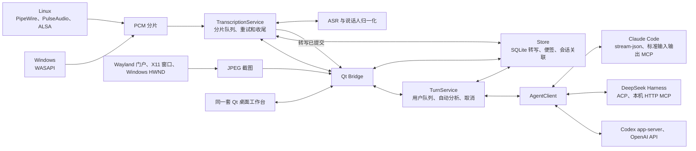

# 听序的跨平台架构评估

Linux 和 Windows 共用 Qt 工作台、转写队列、AI 回复调度与持久化实现。Bridge 将用户操作交给两个 Python 服务，负责原生对话框、截图选择、Qt 线程投递和界面状态发布。平台差异集中在音频与画面采集、系统目录及外部程序启动。

## 代码边界和实际数据流

转写完成后，TranscriptionService 发布包含会议 ID、末尾时间和是否有文字的通知。Bridge 将通知切回 Qt 主线程交给 TurnService。后者绑定当前会议和 Agent，决定是否立即分析。四种 Agent 经同一份工具契约读写当前会议的转写和便签。

同一主题的不同场次可以续接同一个远端会话。SQLite 按「主题、供应商」保存会话 ID，每轮发送仍携带当前场次的标识。存储层用当前会议的归属和创建顺序限定历史查询。往次会议的本场便签只供读取。主题共享卡片另行按主题存储，每次更新同时校验当前会议所属主题和卡片版本，避免覆盖另一位编辑者的修改。开始新场并连接 AI 时，调度器筛选往期未结事项；提醒和该场的发送记录在同一 SQLite 事务中提交。独立会议继续使用原有的按场绑定。升级与续接可分别通过存储测试和桌面场景复验。[主题存储测试](../tests/test_topics.py) · [桌面回归](../tests/e2e/meeting_topics.py)

- **转写队列** 先登记音频，再交给识别线程。保存发言和删除数据库任务处于同一事务，提交成功后才删 WAV。正常停止会排空尾片，退出或提交失败会将未完成任务留给下次重试。[转写服务](../meeting_agent/transcription_service.py) · [故障与恢复测试](../tests/test_transcription_service.py)
- **AI 回复调度** 在同一会议连接中串行发送请求，按 FIFO 处理用户插话并合并自动分析。每轮分配独立取消标记，过期的工具请求、流式文本和完成事件会被丢弃。服务接受线程投递和取帧回调，可在普通 Python 测试中运行。[轮次服务](../meeting_agent/turn_service.py) · [调度测试](../tests/test_turn_service.py)
- **存储层** 提供工作台快照、全文查找、近期上下文、音频任务和会话绑定接口。OpenAI 的账号会话索引与工具回执保留原数据库文件，SQL 同样由存储层负责。已有会议库首次打开时自动补建时间索引。[存储层](../meeting_agent/storage.py)

| 边界 | 两端复用的内容 | 平台或供应商承担的工作 |
| --- | --- | --- |
| 桌面和界面 | QtWebEngine 加载同一组本地 HTML、CSS 和 JS。QWebChannel 将命令、状态和流式文本接入同一个会议工作台。 | Qt 选择 Wayland、X11 或 Windows 平台插件，文件和窗口选择经过桌面接口。[桌面入口](../meeting_agent/__main__.py) · [界面逻辑](../meeting_agent/ui/app.js) |
| 声音到转写 | 所有设备和文件来源先产生 16 kHz、单声道、16 位小端 PCM。一个 AudioCapture 负责分片、时间戳、停止和尾音，ASR 接收 WAV 并统一输出带时间范围的 Segment。 | Linux 枚举 PipeWire、PulseAudio 和 ALSA，Windows 原生子进程负责 WASAPI。网络服务的请求格式、轮询、时间单位与说话人差异在 ASR 内部消化。[音频入口](../meeting_agent/capture.py) · [ASR](../meeting_agent/asr.py) · [Windows 原生音频](../windows/native/audio.cpp) |
| 会议画面 | 上层使用同一组开始、请求新帧、停止接口，获取本机保存的 JPEG。Agent 发送附件时复用该结果。 | Wayland 处理门户授权与 PipeWire 流，也支持选择经 XWayland 显示的单个窗口，X11 选取并截取窗口，Windows 选择 HWND 并调用原生截图程序。Windows 的选择框在 Qt 主线程执行，后续抓帧在工作线程执行。[画面生命周期](../meeting_agent/screen_capture.py) · [Windows 适配器](../meeting_agent/windows_capture.py) |
| 会议记录和看板 | 一套 SQLite 表保存发言、音频分片任务和便签。提交转写与移除对应任务处于同一事务中。界面和 Agent 最终调用同一个 Store.tool，修改与删除同时限定会议 ID 和便签 ID。 | 系统差异主要是 XDG 与 LOCALAPPDATA 目录。导入媒体保存本机路径，换机器后仍需提供相应媒体。[数据层](../meeting_agent/storage.py) · [目录选择](../meeting_agent/runtime.py) |
| Agent | AgentClient 调度连接、建会话、续接、发送、取消和关闭。附件读取、工具参数校验及按会议执行的回调可由多个 Agent 复用。 | HTTP 流、Codex app-server 和外部 CLI 各自处理原生协议、身份、会话 ID、图片格式和取消动作。可列出的历史范围由对应服务决定。[会话入口](../meeting_agent/agents.py) · [材料](../meeting_agent/agent_materials.py) · [工具定义](../meeting_agent/agent_tools.py) |

例如，Windows 应用回环和 Linux 单应用播放流在进入 AudioCapture 后走同一条转写路径。说话人编号或跨分片对齐有误时，可以用一份 WAV 复现实例并修正两端。反过来，某个 Windows 版本的进程回环不可用，应由设备枚举反映能力，避免让转写、数据层或界面推断 Windows 构建号。

## 这次增加两个 Agent 时实际复用了什么

AgentBackend 协议约定五个异步操作，供应商注册表统一给出名称、连接提示、可执行文件配置、附件格式和后端构造方法。设置页和连接页读取同一份清单。三个本地后端都使用 LocalCLI 查找并启动宿主程序。Claude 适配其 stream-json 协议，DeepSeek 适配 ACP。同一个 AgentClient 保证一个连接同时只处理一个操作，并负责取消和释放连接。[供应商注册](../meeting_agent/agent_providers.py) · [宿主启动器](../meeting_agent/local_cli.py) · [Claude](../meeting_agent/agent_claude.py) · [DeepSeek](../meeting_agent/agent_deepseek.py)

两个本地 CLI 访问同一份会议工具定义和参数校验。Claude 的双向标准流转发 MCP 请求，DeepSeek 的 ACP 会话使用带随机凭据、仅监听本机回环地址的 MCP 端点。两条路径最终都调用绑定当前会议的 Store.tool。每场会议现在按供应商分别保存最近的会话 ID，旧库中原有的单条关联会在打开时迁入。切换供应商后可以回到各自的会话。[MCP 处理](../meeting_agent/meeting_mcp.py) · [会议关联](../meeting_agent/storage.py)

## 单文件交付和本机 CLI

AppImage 与 Windows 单文件 EXE 各自打包 Qt、Python 和媒体工具。桌面的授权门户、声音服务、用户安装的 Agent 及其登录状态仍属于宿主系统。Codex、Claude Code 和 DeepSeek Harness 均从用户安装的位置启动。程序启动成功可以验证 GUI 运行时，调用一个已安装 CLI 还需要验证下一层进程环境。[Linux 入口](../packaging/linux/AppRun) · [Windows 入口](../packaging/windows/entry.py)

- **Linux。** AppRun 会设置 PATH、PYTHONHOME、PYTHONPATH、LD_LIBRARY_PATH 和 Qt、GStreamer 等变量。包内 FFmpeg 需要随包的库，外部 CLI 则可能使用自己的 Node、Python 或动态库。AppRun 现在记录它修改的宿主变量，LocalCLI 为外部程序还原，保留当前用户的登录配置与网络设置。设置页也可指定绝对路径，解决桌面 PATH 与交互终端不同的问题。
- **Windows。** PyInstaller 除了临时解包目录，还会改变 DLL 搜索目录。Windows 启动器在单独的进程内恢复 DLL 搜索目录，使用 Job Object 管理 CLI 和它启动的子进程。外部程序通过原生 EXE 或 npm 包声明的入口启动，材料和提示词通过标准输入发送。测试在含中文和空格的路径运行 Windows 可执行文件，分别取消请求、终止父进程，并用 Win32 进程句柄确认孙进程也退出。[原生启动器](../windows/native/host.cpp) · [启动器验收](../tests/windows/host_cli.py) · [PyInstaller 外部程序说明](https://pyinstaller.org/en/stable/common-issues-and-pitfalls.html#launching-external-programs-from-the-frozen-application)

## 剩余耦合与改进顺序

| 优先级与触发条件 | 现有代码的具体影响 | 建议的边界与验收 |
| --- | --- | --- |
| 中。增加下一个音频或画面后端时 | 音源枚举和启动命令在两个函数中按 kind 分支。画面类同时维护公共生命周期、Wayland 管线和 X11 抓图。Windows 模块导入的 QtWidgets 还包括原生选窗所需控件。[音源枚举与命令](../meeting_agent/capture.py) · [截图入口](../meeting_agent/screen_capture.py) | 届时将每种音频后端的枚举和开流放在一起，保留共用的 PCM 读取与分片。把选择窗口的 GUI 动作同接收目标标识后取帧的后端分开。以现有单流隔离、窗口刷新和停止释放测试作为验收。 |
| 中。新增 ASR 服务时 | ASR 已统一 Segment，供应商上传、返回值解码与说话人拼接还在同一模块中。[ASR 转换](../meeting_agent/asr.py) | 接入第三个供应商时可拆分请求与结果归一化，继续复用跨分片的说话人跟踪和转写队列。 |
| 持续。更新 Qt、打包工具或外部 CLI 版本时 | Linux 与 Windows 使用不同的 Qt 运行时，外部 CLI 又可由用户独立升级。源码级协议测试无法检出包内库冲突、Windows 入口解析或系统窗口选择问题。[Linux 构建依赖](../packaging/linux/Dockerfile) · [Windows 构建依赖](../packaging/windows/build-requirements.txt) | 单元层检查协议与持久化。从两端的成品运行同一套会话操作，覆盖会话恢复、附件、便签及取消。原生采集按能力测试。保留「真实服务」「本地协议模拟」「Wine」「原生 Windows」四种证据的区别。[桌面验收记录](acceptance.md) |

## 开发构建中已验证的边界

- Linux 发布版从真实 GUI 连接 Claude Code 和 DeepSeek Harness，两个 CLI 都读取了附件并创建便签。完整退出后分别恢复了原会话。同一会议来回切换两家供应商，还验证了绑定能分别保留。Claude 使用已登录的真实服务，DeepSeek 使用官方 CLI 与本机模拟模型端点，测试环境没有 DeepSeek 官方账户凭据。[桌面会话验收](../tests/e2e/local_agents.py) · [版本与能力](../README.md)
- Windows 发布版在新装的原生 Windows 10 21H2 桌面和隔离的 Wine 桌面上运行。Windows 版 Claude Code 和 DeepSeek Harness 都从 GUI 接收附件、检索转写、建立便签并显示回复。在原生桌面的同一场会议里来回切换，两家分别恢复了各自的会话。DeepSeek 在本地 NTFS 首次连接用时约 76 秒，验证了从成品在用户系统上测量启动时限的必要性。两项 CLI 验收均使用本机模拟模型端点。同一 EXE 在 Wine 中还验证了真实 SiliconFlow 转写、末帧画面和 OpenAI 协议。此前 Windows 11 PE 的覆盖范围是原生采集组件。[Windows 复验命令](../packaging/windows/README.md) · [分平台验收记录](acceptance.md)
- 调整采集和持久化边界时，可回归 Linux 双播放流隔离、Wayland/X11 窗口刷新、Windows WASAPI、停止时写入尾音，以及重启后重复提交同一分片。这些用例能发现拆分造成的丢帧、串流、丢字与重复记录。[Linux 单流验收](../tests/e2e/linux_streams.py) · [Windows 采集验收](../tests/windows/README.md) · [会议数据回归](../tests/test_meetings.py)
